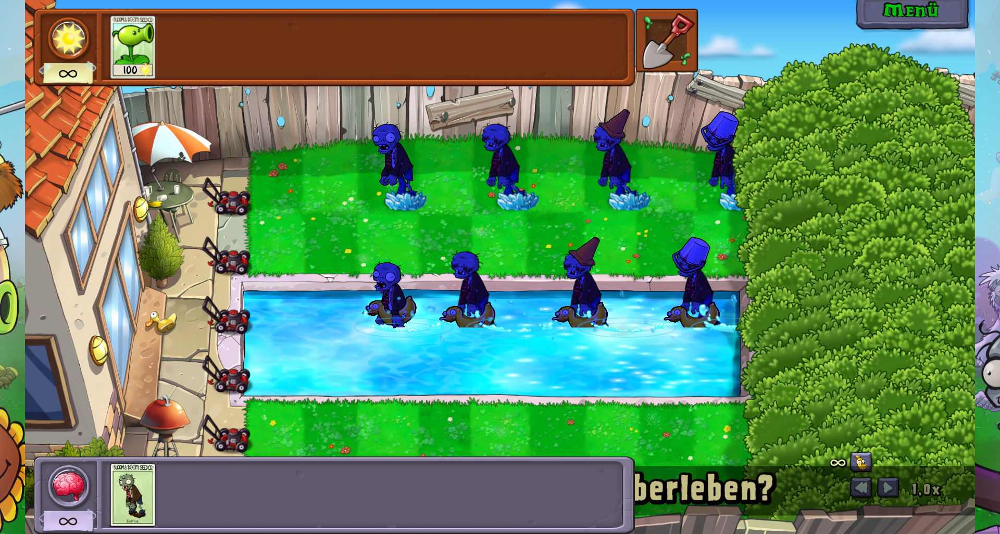
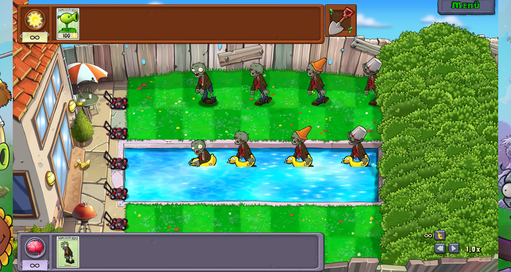

# Native zombie colour review

Status: DONE. Verified on 2026-11-06 with Zombie Library 1.3.1 and Fusion Mod
22.2.3. Both Release builds complete without errors or warnings. Colour and
registry regressions pass; Fusion's static checks report 383 active recipes,
286 pending recipes, and zero errors.

The shared adapter reuses the game's compiled SkeletonAdditive shader. The
[native CPU and shader evidence](README.md) establishes the colour operation;
imported bodies, armour and synthetic ducks supply the same native material
inputs. SpriteRenderer provides the required position, colour and UV vertex
channels. Native materials remain unmodified, and owned material copies are
shared and disposed by the importing artwork family.

The live Debug Mod API review creates eight actors in one temporary Pool
session: native Normal, Eyes, Conehead Eyes and Buckethead Eyes, once on land
and once in water. It captures normal rendering, applies real native chill and
freeze state with `debug.zombie.set`, then removes ice and waits for chill to
expire fully. `zombies {"visuals":true}` records actual native status and active
renderers. [Selected API evidence](runtime.json) includes all three stages.

The reviewed screenshots show the same native cold treatment on imported
bodies, hats and ducks. Black outlines and texture details remain visible;
characters do not become flat colour silhouettes. Pool waterlines, shadows,
transparent edges and per-sprite texture binding remain correct. Full thaw
restores normal skin, clothing, armour and duck colours without stale tint.

The armour path uses the current head animation's source alpha once. Offline
regression covers changing source alpha and native fade without accumulation
or previous-frame feedback. Other colour inputs are forwarded to the original
shader rather than approximated with another fixed tint or sprite lerp.

The temporary session does not request profile mutations. Speed is restored,
the game exits regularly, and installed DLL hashes match the tested builds.
The complete raw API records and game log are retained locally under
`/home/kevin/modding/pvzreplanted/.test-runs/zombie-colors-native-shader-20261106/`.
Only the already documented teardown errors appear in the shutdown log; there
are no new runtime errors from the colour adapter.
